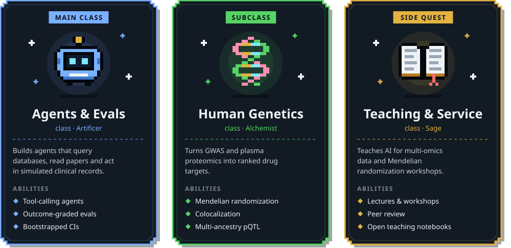

  

  
  
  
  
  
  
  

I build AI agents that do scientific work, and the evaluations that test them. I started in machine learning, with inverse reinforcement learning at Mila, then spent my PhD at McGill on human genetics and proteomics. Papers and talks are on [my website](https://chenyangsu.github.io).

  

## Toolkit

`Python` · `R` · `Bash` · `PyTorch` · `vLLM` · `Claude API` · `Claude Agent SDK` · `Slurm` · `Quarto`

## Activity

<picture>
  <source media="(prefers-color-scheme: dark)" srcset="https://raw.githubusercontent.com/chenyangsu/chenyangsu/output/snake-dark.svg" />
  <source media="(prefers-color-scheme: light)" srcset="https://raw.githubusercontent.com/chenyangsu/chenyangsu/output/snake-light.svg" />
  
</picture>

## Contact

Email is best: cysu [at] stanford [dot] edu.

Born in Kaohsiung. Grew up in Taiwan, Texas, Washington and British Columbia, and trained in Montréal. I speak English, Mandarin and Taiwanese.

