  

  
  
  
  
  
  
  

I build AI agents that do scientific work, and the evaluations that test them. I started in machine learning, with inverse reinforcement learning at Mila, then spent my PhD at McGill combining proteomics with Mendelian randomization to find proteins that cause disease and could be drug targets. From October 2026 I am a Postdoctoral Scholar in Biomedical Data Science at Stanford, working on agents and evaluations for genetics and rare disease.

<table>
  <tr>
    <td width="34%" valign="top">
      <strong>Agents and evals</strong>  
      Agents that query genetics databases, read the literature and act in clinical records. 
      Graded on the end state they leave behind, over repeated trials
    </td>
    <td width="33%" valign="top">
      <strong>Human genetics</strong>  
      Multi-ancestry proteome-wide Mendelian randomization and colocalization. 
      Applied to type 2 diabetes, osteoarthritis, heart failure and intracranial aneurysm
    </td>
    <td width="33%" valign="top">
      <strong>Teaching and service</strong>  
      Lectures on AI for multi-omics data at Academia Sinica, 2025 and 2026. 
      100 peer reviews for 41 journals · IGES Young Investigators Committee
    </td>
  </tr>
</table>

## Selected papers

- **Nature Communications**, accepted 2026. *Disentangling osteoarthritis-specific genetic effects from obesity to identify novel therapeutic targets.* First author. [medRxiv](https://doi.org/10.1101/2025.09.23.25336398) · [talk](https://youtu.be/6xE2DROh_30?t=2531)
- **The Lancet Haematology**, 2025. *Machine-learning models to predict iron recovery after blood donation.* Co-first author. [Paper](https://doi.org/10.1016/S2352-3026(25)00068-7)
- **The New England Journal of Medicine**, 2025. Two letters, on [semaglutide in MASH](https://doi.org/10.1056/nejmc2509454) and on [polygenic risk scores for prostate cancer screening](https://doi.org/10.1056/nejmc2507786). Corresponding author.
- **Scientific Reports**, 2023. *Circulating proteins to predict COVID-19 severity.* Co-first author. [Paper](https://doi.org/10.1038/s41598-023-31850-y)
- **ICLR**, 2021, spotlight. *Regularized inverse reinforcement learning.* Joelle Pineau's lab at Mila. [Paper](https://openreview.net/forum?id=HgLO8yalfwc)
- **Preprint**, under revision at *Genome Medicine*. *Multi-ancestry proteome-phenome-wide Mendelian randomization offers a comprehensive protein–disease atlas and potential therapeutic targets.* [medRxiv](https://www.medrxiv.org/content/10.1101/2024.10.17.24315553v2) · [atlas](https://broad.io/protein_mr_atlas), hosted with the Broad Institute's Common Metabolic Disease Knowledge Portal

All 55 publications are on [Google Scholar](https://scholar.google.com/citations?user=KJGE-kYAAAAJ&hl=en).

## Talks

Invited talks at the Broad Institute (Neale and Natarajan labs), Stanford (Snyder lab), Academia Sinica, National Taiwan University and the Banff International Research Station. Platform talks at ASHG 2024 and 2026.

Recorded: [National Taiwan University, 2025](https://www.youtube.com/watch?v=6HUOCZs7faI&list=PLybwqWCmSjp4gSd6cI0pvRSIuRY3MUjq6&index=9) · [TAGC, UW–Madison, 2025](https://youtu.be/6xE2DROh_30?t=2531) · [BIRS, 2024](https://www.birs.ca/events/2024/5-day-workshops/24w5292/videos/watch/202407251114-Su.html) · [all recordings](https://www.youtube.com/playlist?list=PLUI6xDhXtJkXSeV3RrdO43Yw0MIZTlzKc)

## Background

<table>
  <tr><td><code>2026–</code></td><td><strong>Stanford University</strong></td><td>Postdoctoral Scholar, Biomedical Data Science</td></tr>
  <tr><td><code>2026</code></td><td><strong>University of Wisconsin–Madison</strong></td><td>Postdoctoral Fellow, Population Health Sciences, with Tianyuan Lu</td></tr>
  <tr><td><code>2026</code></td><td><strong>McGill University</strong></td><td>Postdoctoral Fellow, Human Genetics</td></tr>
  <tr><td><code>2022–2025</code></td><td><strong>McGill University</strong></td><td>PhD, Quantitative Life Sciences, with Sirui Zhou</td></tr>
  <tr><td><code>2022</code></td><td><strong>Hinge Health</strong></td><td>Data Science Intern, Computer Vision Science</td></tr>
  <tr><td><code>2020–2022</code></td><td><strong>McGill University · Mila</strong></td><td>MSc, Computer Science, with Joelle Pineau and Brent Richards</td></tr>
  <tr><td><code>2016–2020</code></td><td><strong>McGill University</strong></td><td>BSc, Computer Science and Biology</td></tr>
</table>

<strong>Funding and awards</strong>

 

- Anthropic AI for Science Rare Disease Research Grant, $50,000 USD in Claude compute credits (2026)
- FRQS Postdoctoral Research Scholarship, $110,000 CAD (2026)
- Biswas Family Foundation Fast Grant, $25,000 USD (2026)
- CIHR Canada Graduate Scholarship – Doctoral, $113,333 CAD (2023)
- FRQS Doctoral Training Fellowship, $96,000 CAD (2022)
- ICLR spotlight (2021) · ASHG platform talks (2024, 2026) · XPRIZE Pandemic Response Challenge world finalist with a Mila team (2021)

## Toolkit

`Python` · `R` · `Bash` · `PyTorch` · `vLLM` · `Claude API` · `Claude Agent SDK` · `Slurm` · `Quarto` · Mendelian randomization · colocalization · GWAS and pQTL · plasma proteomics

## Activity

<picture>
  <source media="(prefers-color-scheme: dark)" srcset="https://raw.githubusercontent.com/chenyangsu/chenyangsu/output/snake-dark.svg" />
  <source media="(prefers-color-scheme: light)" srcset="https://raw.githubusercontent.com/chenyangsu/chenyangsu/output/snake-light.svg" />
  
</picture>

## Contact

Email is best: cysu [at] stanford [dot] edu.

Born in Kaohsiung. Grew up in Taiwan, Texas, Washington and British Columbia, and trained in Montréal. I speak English, Mandarin and Taiwanese.

